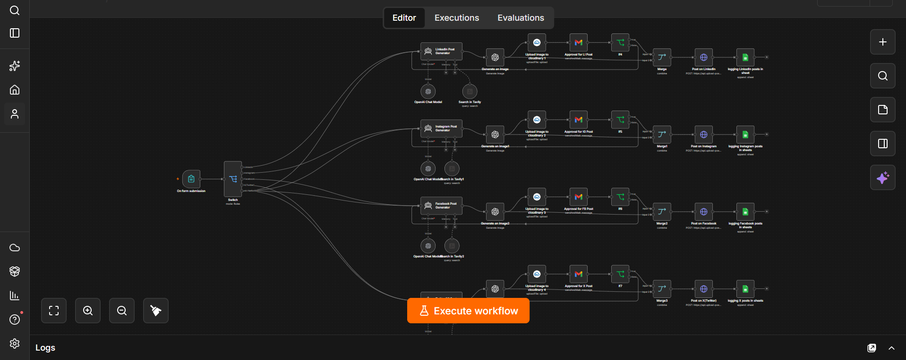
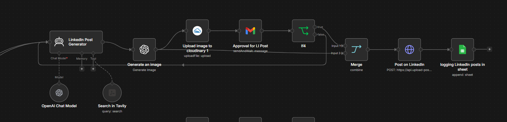
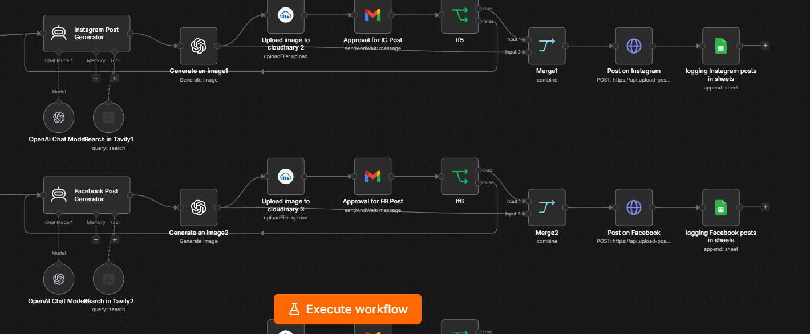
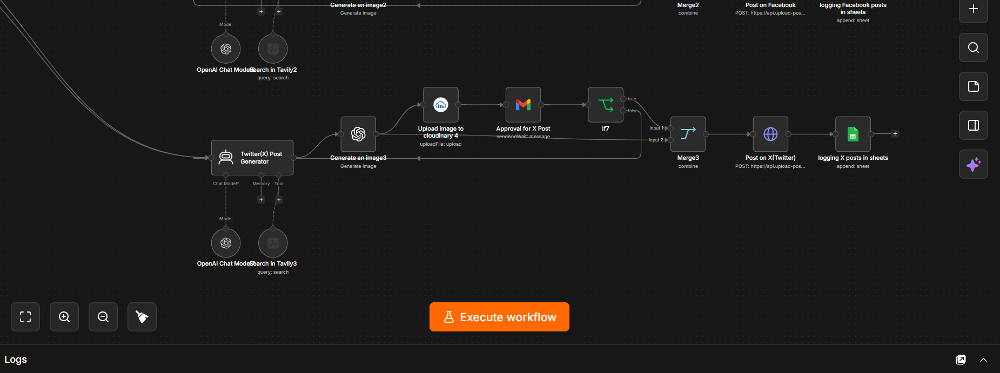

# 📣 End-to-End Social Media Automation

An end-to-end **n8n** workflow that turns a single post idea into platform-ready content for **LinkedIn, Instagram, Facebook and X (Twitter)** — with AI research, AI-generated images, **human approval by email**, automatic publishing and Google Sheets logging.



---

## ✨ Features

- 📝 n8n Form to submit a post idea, target platform and content type
- 🎯 Publish to one platform or **all four at once**
- 🔎 Web research with **Tavily** so posts are current and accurate
- 🤖 Separate AI agents tailored to each platform's tone and format
- 🖼️ AI-generated image for every post
- ☁️ Images hosted on **Cloudinary**
- ✅ **Human-in-the-loop approval** via Gmail before anything is published
- 🔁 Rejected posts are automatically regenerated
- 🚀 Publishing through the **Upload-Post** API
- 📊 Every published post logged to Google Sheets

---

## 🔄 How It Works

```text
Form ─► Switch (platform) ─► [Platform] Post Generator (AI Agent + Tavily)
                                   │
                                   ▼
                          Generate image (OpenAI)
                                   │
                                   ▼
                          Upload to Cloudinary
                                   │
                                   ▼
                     Gmail approval (send & wait) ─► If approved?
                                   │                    │ no ─► regenerate post
                                   ▼ yes
                     Merge ─► Post via Upload-Post API ─► Log in Google Sheets
```

This pipeline runs independently for each selected platform (LinkedIn, Instagram, Facebook, X).

1. **On form submission** – enter the post idea, choose a platform and content type.
2. **Switch** – routes to one platform or to all four.
3. **Post Generator agents** – research the topic with Tavily and write a platform-specific post.
4. **Generate an image** – OpenAI creates a matching image.
5. **Cloudinary** – hosts the image so it can be previewed.
6. **Approval email** – Gmail sends the post text and image for approval and waits for your response.
7. **If** – approved posts continue; rejected posts are sent back to be regenerated.
8. **Post on …** – publishes the text and image via the Upload-Post API.
9. **Google Sheets** – logs each published post.

---

## 🛠️ Tech Stack

| Tool | Purpose |
| --- | --- |
| n8n | Workflow automation |
| n8n Forms | Post idea input |
| OpenAI (`gpt-5-mini`) | Post writing (AI agents) |
| OpenAI (`gpt-image-2`) | Image generation |
| Tavily | Web research tool |
| Cloudinary | Image hosting |
| Gmail | Approval emails (send & wait) |
| Upload-Post API | Publishing to social platforms |
| Google Sheets | Post logging |

---

## 📥 Setup

1. Download [`workflow.json`](workflow.json).
2. In n8n, go to **Workflows → Import from File** and select it.
3. Install the community nodes if needed: **Tavily** (`@tavily/n8n-nodes-tavily`) and **Cloudinary** (`n8n-nodes-cloudinary`).
4. Add your credentials:
   - **OpenAI API** – chat models and image generation
   - **Tavily API** – search tools
   - **Cloudinary** – image uploads
   - **Gmail OAuth2** – approval emails
   - **Google Sheets OAuth2** – logging
5. In the four **Post on …** HTTP Request nodes, replace `YOUR_UPLOAD_POST_API_KEY` with your [Upload-Post](https://upload-post.com) API key, and set the `user` field to your Upload-Post profile name.
   > 💡 Tip: store the key as an n8n **Header Auth** credential instead of pasting it into the node.
6. In the four **Approval for …** Gmail nodes, change the recipient to your own email address.
7. Point the Google Sheets logging nodes to your own spreadsheet.
8. Activate the workflow and open the form URL.

### Form fields

| Field | Type | Options |
| --- | --- | --- |
| Post Idea / Topic | Text (required) | — |
| Publish To | Dropdown (required) | LinkedIn, Facebook, Instagram, X (Twitter), All Platforms |
| Content Type | Dropdown | Educational, Promotional, Informational, Personal/Story |

---

## 📸 Screenshots

**LinkedIn pipeline**



**Instagram & Facebook pipelines**



**X (Twitter) pipeline**



---

## 💡 Use Cases

- Personal branding across multiple platforms
- Small business and startup marketing
- Content creators who want consistent posting
- Agencies managing social content with an approval step

---

## 📜 License

This project is licensed under the [MIT License](LICENSE).
